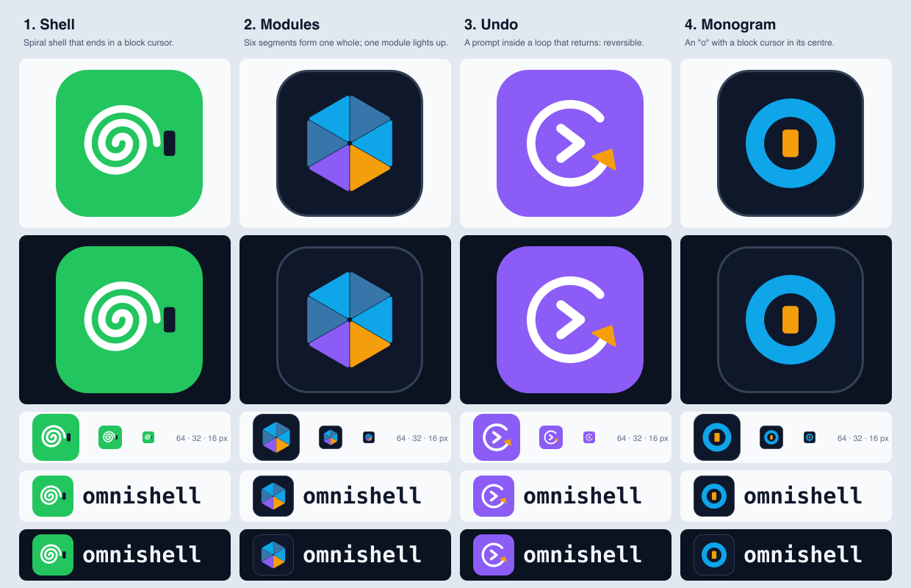

# omnishell logo concepts

Four draft directions for the omnishell logo, each as a standalone SVG mark
(`omnishell-logo-*.svg`, 256×256 rounded-square tile, usable as an avatar) and
side by side in [`overview.svg`](overview.svg) (also rendered as
[`overview.png`](overview.png)). The sheet shows every mark large on light and
dark backgrounds, at 64/32/16 px, and combined with a wordmark.

The wordmark in the overview is plain monospace text for comparison only; it is
not a designed wordmark.

## References

What the logos of comparable tools do well:

| Tool | Mark | Takeaway |
|:--|:--|:--|
| [Starship](https://github.com/starship/starship/tree/master/media) | Rocket in a gradient circle | A picture of the name, one strong silhouette, readable as a tiny avatar |
| [zoxide](https://github.com/ajeetdsouza/zoxide/tree/main/contrib) | Keycap with a prompt and a "Z" | Literal and instantly recognisable; light and dark variants ship together |
| [mise](https://github.com/jdx/mise/tree/main/docs/public) | Chef character plus lowercase wordmark | A pun on the name (*mise en place*) gives the tool personality |

Common thread: each mark comes from the tool's own name or workflow, has a
single silhouette, and survives as a small square avatar.

## Concepts

| # | Direction | Idea | Strengths | Weaknesses |
|:-:|:--|:--|:--|:--|
| 1 | **Shell** | Spiral shell ending in a block cursor | Direct link to the name and the 🐚 already used in the README; friendly | Fine spiral turns blur at 16 px |
| 2 | **Modules** | Six segments form a hexagon, one segment lit amber | Says "modular" and "all in one" at once; uses the full palette | Busiest of the four; weakest at 16 px |
| 3 | **Undo** | A prompt inside a loop that returns | Encodes *reversible*, the tool's distinguishing trait | Close to generic "refresh / history" icons |
| 4 | **Monogram** | An "o" with a block cursor in its centre | Simplest and boldest; holds up at every size | Least specific; could be mistaken for a record or power icon |

## Recommendation

**Concept 1 (Shell)** as the main mark.

- It is the only direction that is recognisably *about a shell* without the
  generic terminal cliché, and it matches the 🐚 the project already uses.
- A single bold spiral plus one cursor block is memorable, friendly and
  distinct in a list of CLI tools.
- To fix the small-size weakness, thicken the stroke and reduce the spiral to
  two or three turns for the 16/32 px versions.

Concept 4 is the fallback if a calmer, more minimal look is preferred; it also
works as a favicon next to the full mark.

## Palette

Tiles and strokes use the README accent palette: green `#22c55e`, blue
`#3776ab`, sky `#0ea5e9`, purple `#8b5cf6`, amber `#f59e0b`, plus ink
`#0f172a` for dark tiles.
